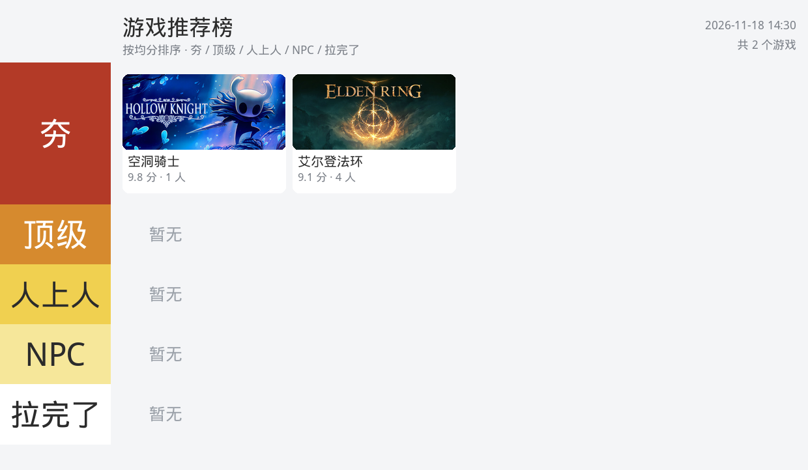

# 群游戏推荐榜 · astrbot_plugin_game_board

QQ 群里一起给游戏打分，自动出「夯 / 顶级 / 人上人 / NPC / 拉完了 / 屎」六档榜单图。

群友 `/推荐 艾尔登法环`，插件自动从 Steam（搜不到再走 Bangumi）抓封面、标签和简介，然后收下第一票。
其他人 `/评分 艾尔登法环 9.5 神作` 继续投票，`/榜单` 出一张表格图，`/游戏 艾尔登法环` 出一张 Steam 风格的详情卡。

## 预览

`/榜单`：



`/游戏 空洞骑士`：


## 特性

- **自动抓取**：Steam 商店搜索 + 详情（封面、类型标签、简介），搜不到自动兜底 Bangumi；都没有时支持手动发封面图建条目。
- **六档定级**：均分 1 / 5 / 6 / 7 / 9 切五刀 —— `0–1 屎`、`1–5 拉完了`、`5–6 NPC`、`6–7 人上人`、`7–9 顶级`、`9–10 夯`（按下限归属，1.0 起算拉完了）。
- **标签筛选榜单**：`/榜单 动作`、`/榜单 动作 独立`（并集）、`/榜单 动作+独立`（交集）。
- **小众游戏单独看**：打分人数不足 5 人的游戏可以 `/小众游戏` 单独出榜，总榜仍然照常收录。
- **Steam 风格详情卡**：深色卡片 + 大图 + 标签 + 评分 + 评论区；**推荐人的评论置顶**，其余按时间排列，带头像与昵称。
- **每群一个榜名**：`/榜名 摸鱼游戏榜`，之后出图标题就是它。
- **群友补标签**：`/贴标签 空洞骑士 魂系 手绘`，标签在本群生效，`/榜单 魂系` 直接筛。
- **数据隔离**：游戏库跨群共享（封面只抓一次），**分数按群独立统计**；手动添加的游戏、自定义标签、榜单名都只在本群生效。
- **交互只认发起人**：`/推荐`、`/点评` 这类需要你再回一句的流程，只有发起指令的本人回复才算数，群里别人插话不会替你打分；2 分钟没回就自动作废。
- **纯规则实现**：不调用 LLM，不产生额外 token 费用。

## 指令

| 指令 | 别名 | 说明 |
|---|---|---|
| `/推荐 游戏名` | `/recommend` | 搜索并让游戏上榜，需要先打 0–10 分（可附评论） |
| `/打分 游戏名 分数 [评论]` | `/评分` `/rate` | 投票或改票，支持 `9.5`；名字带数字时用引号：`/打分 "Left 4 Dead 2" 10 神作` |
| `/点评 游戏名` | `/评论` `/comment` | 只补一条评论，不打分 |
| `/榜单详情 游戏名` | `/游戏` `/game` | Steam 风格详情卡 |
| `/榜单 [标签...]` | `/board` | 总榜；带标签则筛选排行，`a+b` 表示交集 |
| `/小众游戏榜` | `/小众游戏` `/niche` | 只看打分人数不足 5 人的游戏 |
| `/贴标签 游戏名 标签...` | `/加标签` `/tag` | 给作品补标签，榜单可按它筛 |
| `/添加 游戏名` | `/自定义` `/manual` | Steam/Bangumi 都没收录时手动建条目：发封面、标签、分数、评论，仅本群可见 |
| `/撤分 游戏名` | `/撤评` `/unrate` | 撤销自己的那一票 |
| `/撤榜 游戏名` | `/remove` | 从本群榜单移除（推荐人本人或管理员） |
| `/榜名 [名称]` | `/boardname` | 改本群榜单标题，`/榜名 重置` 恢复默认 |
| `/榜单帮助` | `/游戏帮助` `/gamehelp` | 群里随时查全部指令 |

旧指令名（`/评分` `/评论` `/游戏` …）都保留为别名，老群员不用重新学。

## 配置

安装后在 WebUI 插件配置页可调：

| 配置项 | 默认 | 说明 |
|---|---|---|
| `min_votes_niche` | 5 | 小众榜门槛（票数少于该值） |
| `board_title_admin_only` | false | 关时任何群友都能用 `/榜名` 改本群榜单标题 |
| `enable_steam` | true | Steam 数据源开关 |
| `enable_bangumi` | true | Bangumi 兜底开关 |
| `allow_manual` | true | 允许手动添加游戏 |
| `steam_language` / `steam_country` | schinese / cn | Steam 返回语言与区域 |
| `cache_days` | 7 | 游戏信息缓存天数 |
| `rate_limit_count` / `rate_limit_window` | 3 / 10 | 写操作限频 |
| `comment_max_len` | 200 | 单条评论字数上限 |
| `comment_max_per_game` | 20 | 每人每游戏评论条数上限 |
| `pin_recommender_comment` | true | 详情页置顶推荐人评论 |
| `detail_max_comments` | 6 | 详情页最多渲染评论数 |

## 安装

```bash
cd AstrBot/data/plugins
git clone https://github.com/buluger/astrbot_plugin_game_board
# 或在 WebUI 插件页从文件/仓库安装
```

依赖：`aiohttp`（AstrBot 已自带）、`Pillow`。中文字体需要服务器安装文泉驿（Debian：`apt install fonts-wqy-microhei`）或任意 Noto Sans CJK。

## 数据

- 数据目录：`data/plugin_data/game_board/`
- `board.db`：SQLite，游戏库 / 评分 / 评论 / 自定义标签
- `covers/`：封面与大图缓存
- `avatars/`：QQ 头像缓存（按需下载）

## 已知限制

- Steam 商店 API 非官方、有频率限制；插件会把封面缓存到本地，正常使用不会触发限流。
- 群号、QQ 号等仅用于本群统计，不上传第三方。
- 表格图目前一图展示全部游戏；游戏数量过多时会很长，后续版本再考虑分页。

## 许可

MIT
